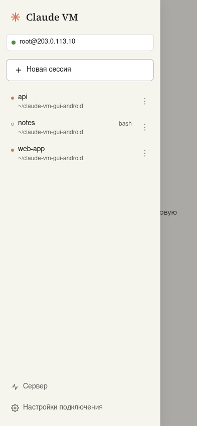
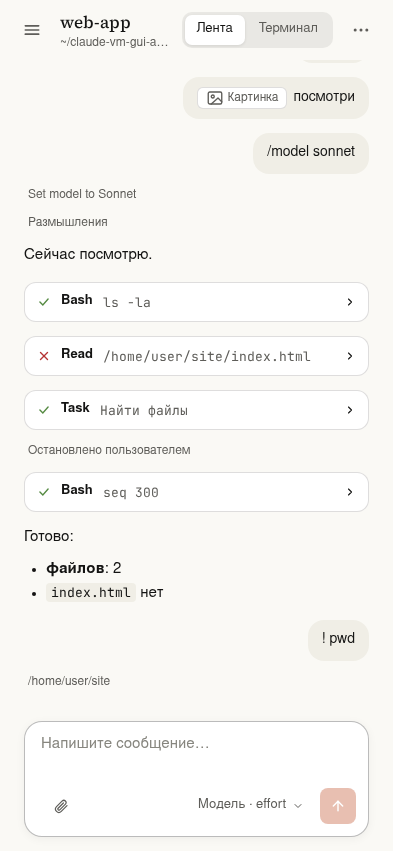
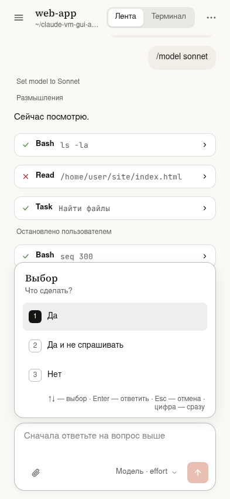
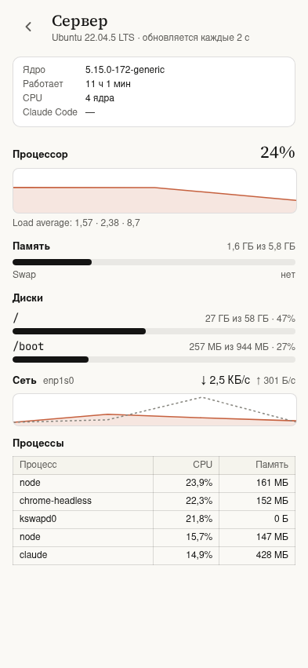
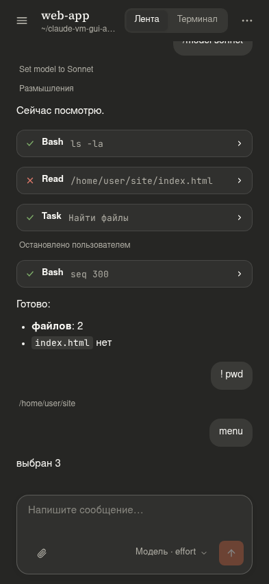
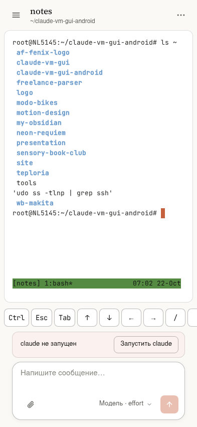

# Claude VM для Android

Android-приложение для работы с [Claude Code](https://docs.claude.com/en/docs/claude-code), который запущен на вашей ВМ (Ubuntu) в tmux.
Это форк Windows-клиента [claude-vm-gui](https://github.com/Liotto1337/claude-vm-gui) (основан на версии 0.2.2): тот же интерфейс в стиле claude.ai, перестроенный под телефон, и та же логика работы с tmux и Claude Code.

Приложение подключается только к вашей ВМ по SSH. К серверам Anthropic напрямую оно не обращается: с ними работает Claude Code на ВМ.

| Сессии | Лента | Меню Claude Code |
|---|---|---|
|  |  |  |
| **Сервер** | **Тёмная тема** | **Терминал** |
|  |  |  |

## Возможности

- **Подключение**: проверка TCP-порта SSH, вход по импортированному SSH-ключу (OpenSSH или PEM, в том числе с парольной фразой) или по паролю, в том числе через keyboard-interactive. Ключ и пароль хранятся в хранилище ключей Android (Keystore, AES-GCM) и в интерфейс не возвращаются. Ключ сервера сверяется с `known_hosts`, как у обычного `ssh`; при несовпадении подключение блокируется.
- **Сессии tmux**: список в выдвижной панели (☰ или свайп от левого края), новая сессия с рабочей папкой и автозапуском `claude`, завершение с подтверждением. Долгое нажатие — меню сессии (закрепить, группа, завершить), ручка ⋮⋮ — перенос пальцем. Раскладка хранится на телефоне отдельно для каждой ВМ; tmux не меняется.
- **Лента вместо терминала**, пока в сессии работает claude: сообщения, ответы в markdown, вызовы инструментов с результатами, «Claude думает…» и «Остановить».
- **Меню Claude Code карточкой**: запрос разрешения, AskUserQuestion, «доверять папке?», `/model` — касанием варианта.
- **Поле ввода**: подсказки по `/` и `@`, картинки из галереи или камеры (📎), модель и effort — одной кнопкой в нижнем листе. Отправка одним касанием: приложение жмёт Enter, только когда поле ввода устоялось, и проверяет, что сообщение ушло.
- **Терминал**: настоящий xterm со строкой клавиш над клавиатурой — Esc, Tab, Ctrl (залипает на одну клавишу), стрелки, `/ | ~ -`, Enter; размер шрифта — щипком, копирование — долгим нажатием.
- **Панель «Сервер»**: CPU графиком, память, диски, сеть, процессы, сведения о системе — одной командой по SSH, на ВМ ничего не ставится.
- **Связь в фоне и уведомления**: пока приложение свёрнуто, соединение держит сервис «Подключено к ВМ» (с кнопкой «Отключиться»), а по всем сессиям приходят уведомления «Claude закончил» и «Claude ждёт ответа» с вопросом. Касание уведомления открывает сессию. При смене сети (Wi-Fi ↔ мобильная) приложение переподключается сразу. Оба режима выключаются в настройках.
- Кнопка «Назад», светлая и тёмная темы (по умолчанию — как в системе); на планшете в горизонтальной ориентации — раскладка как на компьютере.

## Установка

Нужен Android 8 или новее.

1. Скачайте `claude-vm-<версия>.apk` со страницы [Releases](https://github.com/Liotto1337/claude-vm-gui-android/releases).
2. Откройте файл на телефоне и разрешите установку из этого источника, когда Android попросит.
3. Запустите «Claude VM», укажите адрес ВМ и пользователя, вставьте закрытый SSH-ключ (или выберите файл) либо задайте пароль.
4. При первом подключении сверьте отпечаток ключа сервера с выводом `ssh-keygen -lf /etc/ssh/ssh_host_ed25519_key.pub` на ВМ и нажмите «Доверять».

### Что нужно на ВМ

- `tmux` (`sudo apt install tmux`) и установленный Claude Code с выполненным входом.
- Открытая часть вашего ключа в `~/.ssh/authorized_keys` или разрешённый вход по паролю.

Картинки загружаются в `~/.cache/claude-vm-gui/uploads/` и удаляются через 7 дней.

## Разработка

Интерфейс и вся логика — TypeScript и React (`src/`), SSH, хранение секретов, фоновый сервис и уведомления — Kotlin (`android/`). В браузере приложение работает через dev-мост — Node-сервер на `ssh2`; в APK он не попадает (это проверяет сборка).

```bash
npm ci                  # заодно включает git-хук .githooks/pre-commit
npm run bridge          # dev-мост на 127.0.0.1:8790 (CVG_BRIDGE_KEY — путь к ключу)
npm run dev             # интерфейс в браузере
npm test                # модульные тесты
npm run test:int        # интеграционные тесты против ВМ
npm run test:e2e        # E2E в Chromium через мост (в том числе экран телефона)
npm run test:android    # JUnit и Robolectric
npm run android:build   # debug APK
npm run test:smoke      # дымовой тест APK на эмуляторе
npm run screenshots     # скриншоты для README
```

Сборка APK требует JDK 21 и Android SDK (platform 36); окружение — `source scripts/android-env.sh`. Release-сборка подписывается ключом из переменных `ANDROID_KEYSTORE_FILE`, `ANDROID_KEYSTORE_PASSWORD`, `ANDROID_KEY_ALIAS`, `ANDROID_KEY_PASSWORD`; в GitHub Actions (`.github/workflows/android.yml`) — из секретов репозитория, тег `v*` создаёт релиз с APK.

Интеграционные, E2E- и часть JUnit-тестов запускаются на самой ВМ и подключаются к `127.0.0.1` ключом `~/.ssh/cvg_test_ed25519`, разрешённым в `authorized_keys` только с localhost. Без него они пропускаются. Вход по паролю проверяется с `CVG_TEST_SSH_USER` и `CVG_TEST_SSH_PASSWORD`. Тесты работают только с сессиями `cvg-test-*` и отдельными серверами tmux и не отправляют запросов к модели.

`vm.config.json` в `.gitignore`; хук `pre-commit` отклоняет коммит, если адрес ВМ из него встретился в файлах. Исправления из Windows-версии переносятся `git merge upstream/main`.

Карта проекта для Obsidian — в папке [`obsidian/`](obsidian/Claude%20VM%20для%20Android.md), спецификация — `docs/superpowers/specs/2026-10-21-claude-vm-gui-android-design.md`.

## Лицензии

Код — MIT. Шрифты Source Serif 4 и JetBrains Mono — SIL Open Font License. Приложение не связано с Anthropic; Claude и Claude Code — продукты Anthropic.
